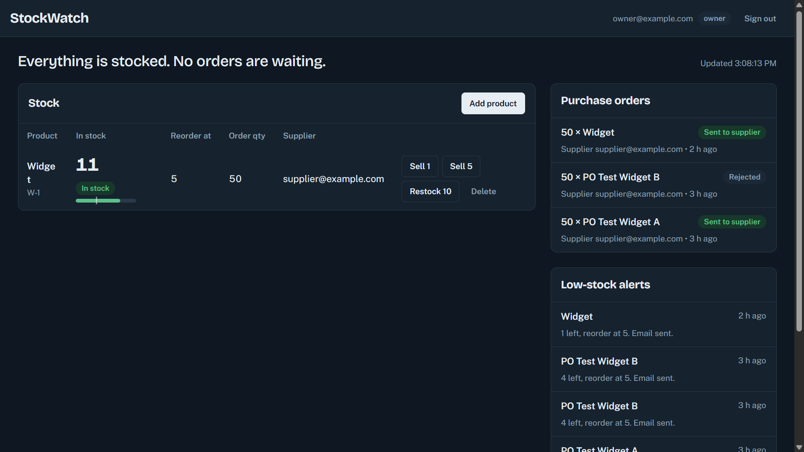
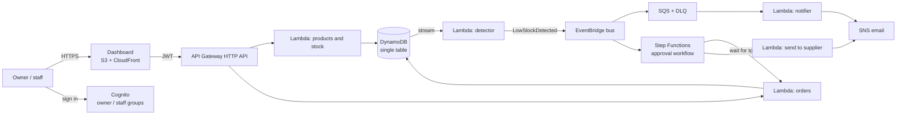
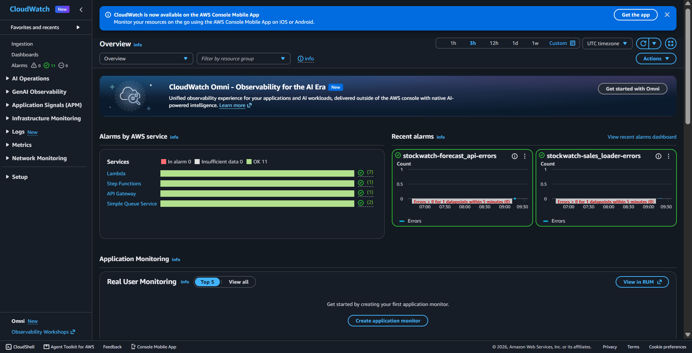
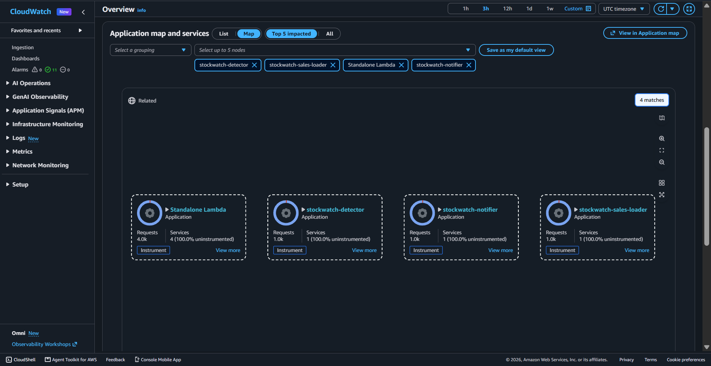
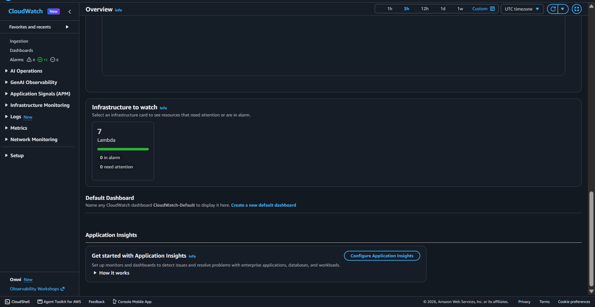

# StockWatch

Event-driven auto-reorder for small retailers, built serverless on AWS with Terraform.

When a product's stock drops to its reorder level, StockWatch notices within seconds, emails the owner, and opens a purchase order. The owner approves it from the dashboard and the supplier is notified. Nothing polls and nothing runs when nobody is selling.



## How it works



1. Staff sell stock through the API. DynamoDB updates it atomically and refuses to go below zero.
2. The DynamoDB stream feeds a detector that emits an event only when stock crosses the threshold, not on every sale below it.
3. EventBridge fans the event out to two places: a queue that sends the alert email, and a Step Functions workflow that creates a purchase order.
4. The workflow pauses for up to 24 hours until an owner approves or rejects the order through the API. Staff cannot approve.
5. On approval the supplier is notified. On rejection or timeout the order is closed.

.png)
.png)

## Design decisions

| Decision | Why |
| --- | --- |
| Fully serverless, no EC2 | Idle cost is close to zero, and there is nothing to patch. |
| DynamoDB single table with one GSI | Every access pattern is a key lookup or a list; no joins needed. |
| Detect threshold crossings, not low stock | One alert per event, not one per sale. |
| Deterministic alert IDs from the stream event ID | Retries can never create duplicate alerts. |
| One open order per product (lock item with expiry) | Repeated dips below the threshold don't create duplicate orders. |
| Conditional updates for approval | Approving twice returns 409 instead of ordering twice. |
| Step Functions with a task token | A human decision is a long wait; Lambda should not sit and wait. |
| DLQs on both the stream and the queue, with alarms | Failures are visible and recoverable instead of silent. |
| Roles checked in the Lambda from the JWT group claim | Authorisation lives next to the data it protects. |

## Security

- Private S3 bucket, reachable only through CloudFront (origin access control). No public access.
- Cognito with admin-only sign-up. API Gateway rejects requests without a valid JWT.
- Separate least-privilege IAM role per Lambda. The one wildcard resource is `states:SendTaskSuccess/Failure`, which AWS does not support resource-level permissions for.
- CORS locked to the dashboard origin. Throttling on the API stage.
- DynamoDB encryption at rest and point-in-time recovery. SQS managed encryption.
- CloudTrail with log file validation into a private, encrypted bucket that denies non-TLS access.

## Operations

- CloudWatch dashboard for API traffic and latency, Lambda errors, queue depth and workflow runs.
- Alarms by email for API 5xx, errors in any Lambda, failed workflows and anything landing in a dead-letter queue.
- Monthly budget with alerts at 50% and 80% actual spend and 100% forecast.
- CI on every push: `terraform fmt`, `validate`, Python compile, JS syntax check.





## Cost

Built and demoed for well under $5. Everything is pay-per-use: Lambda, DynamoDB on-demand, API Gateway, SQS, SNS, EventBridge, Step Functions Standard. The only fixed-ish items are CloudWatch alarms and dashboard (cents). Run `terraform destroy` to remove everything.

## Run it

Requires Terraform 1.5+, the AWS CLI and Python 3.

```bash
cp terraform/terraform.tfvars.example terraform/terraform.tfvars   # set alert_email
cd terraform
terraform init
terraform apply
```

Confirm the SNS subscription email. Create a user in the Cognito console and add them to the `owner` or `staff` group.

Dashboard: the CloudFront URL from `terraform output site_url`. To run it locally instead, apply with `-var="enable_cloudfront=false"`, then write `frontend/config.js` from the outputs and serve `frontend/` on port 8080 or 8081.

Tests: `scripts/smoke_test_phase3.ps1` creates products, drives stock below the threshold, and checks the alert, the order, the 403 for staff, the 409 on double approval and the one-order-per-product rule.

## Sales analytics (optional module)

`terraform/analytics.tf` adds a relational reporting side to the system:

- **VPC** with private subnets that have no internet route, a DynamoDB and S3 gateway endpoint, and one Secrets Manager interface endpoint. No NAT gateway.
- **RDS Postgres** (private, encrypted, password generated and kept in Secrets Manager) stores sales history.
- **Lambda in the VPC** turns each stock decrease on the DynamoDB stream into a sale row (idempotent by stream event ID). A second Lambda serves `GET /forecast`: days of stock left and a suggested order size.
- **ECS Fargate** runs a nightly report (EventBridge schedule, midnight IST) that writes a `daily_report` table and emails a summary through SNS.
- The dashboard shows a forecast column when the module is deployed.

Deploy: run `scripts/install_analytics_deps.ps1`, then `terraform apply`. Test with `scripts/smoke_test_phase7.ps1`, and start the report now with `scripts/run_report.ps1`.

Known limits of this module: the database connection is encrypted but the RDS certificate is not verified, the Fargate task runs in a public subnet (no inbound access) to avoid a NAT gateway, and the database is single-AZ.

## Repo layout

```
terraform/   all infrastructure
lambdas/     products, detector, notifier, orders (Python 3.12, arm64)
frontend/    dashboard (vanilla JS, no build step)
scripts/     smoke tests
```

## What I would add next

- SES with a verified domain to email real suppliers (currently the owner is emailed as the demo).
- Remote Terraform state with locking, and OIDC-based `plan` in CI.
- WAF in front of CloudFront and a custom domain with ACM.
- Pagination in the dashboard beyond 100 products.
